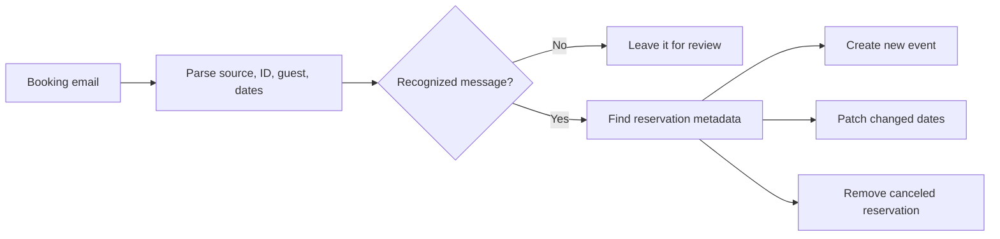

# Booking sync to a shared calendar

## The process

A time-driven Google Apps Script reads reservation messages from the host’s Gmail account. Confirmations create calendar events, changes patch the existing event, and recognized cancellations remove the event associated with that reservation. The reservation identifier is stored in private event metadata and in a small Script Properties index.

## Inputs, decisions, and outputs

Inputs are message subject/body/date, source-specific reservation IDs, a target calendar, property timezone, default check-in/out hours, and the lookback window. A message must match a supported booking or cancellation format. Reservation requests and cancellation-policy notices are ignored.

The output is one calendar event per matched reservation, with source, guest name, stay interval, and private matching metadata. Unchanged bookings refresh the index without another calendar write. Updates deliberately preserve manual event descriptions. A missing local index can be recovered through the event’s reservation tag.

The public edition does not guess a three-night stay when the email lacks both a recognizable date block and a night count. It adds an explicit target-calendar setting rather than writing to the primary calendar by default.

## Setup

1. Create a private Apps Script project in the Google account that owns the booking inbox.
2. Add `Code.gs`, `Config.gs`, and `appsscript.json` from this folder.
3. Enable the advanced Calendar API v3 service. Review the requested Gmail and Calendar permissions.
4. Set `CALENDAR_ID` to a dedicated test calendar. Set timezone, location, check-in/out defaults, earliest relevant check-in, and lookback windows for your property.
5. Leave `ENABLED: false` while reviewing configuration and running the local tests.
6. Use representative messages from your own inbox to check the parsers and proposed dates in a test project. Email layouts can change.
7. Explicitly enable the test project and run `syncReservations` manually. Inspect created/updated/deleted events, guest names, timezones, and matching metadata. Run it again to check idempotency.
8. Only after that review, choose the intended calendar and run `setupTrigger` for the 15-minute schedule. `deleteTrigger` pauses that handler. `backfillReservations` deliberately uses the wider configured lookback.

## Failure handling and verification

An unrecognized message format needs parser review; do not infer that a missing event means no booking exists. A cancellation can remove an event. The bounded duplicate lookup can remove duplicate tagged events. Keep a calendar backup before enabling this on operational data.

The local harness checks confirmation parsing, cross-year dates, cancellation false positives, disabled defaults, no duplicate on a repeated run, changed-date patching, preservation of manual notes, and cancellation cleanup. These mocked checks do not establish that a trigger or permission is configured in another account.

Cleaner assignment, Airtable reconciliation, and cleaner messaging are separate processes. This folder documents Gmail-to-Calendar synchronization.
