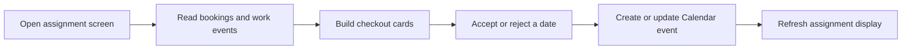

# Cleaner date selection and Calendar assignment

The recovered app lets a cleaner or inspector review upcoming checkout dates, accept or reject an assignment, and save the result to Google Calendar. This is the implemented date-selection part of the “Scheduling cleaners by text” video.

## How the implementation works

1. The interface opens with a role and name, either from a personal link or a role/name choice. It loads assignments immediately and refreshes every minute.
2. `listAssignments` paginates through Calendar events. It recognizes supported booking labels, finds the checkout date, matches cleaning and inspection events by date, and adds the next arriving guest when present.
3. Cards show the date, current assignees, arriving/departing guest labels, same-day turnover, and recognized cancellations. The display covers today through the next 60 days in the property timezone.
4. Accept or Reject sends the selected role, event, work interval, and decision to `respondToAssignment`.
5. Acceptance writes the selected assignee into the event title and appends a timestamped acceptance note. Rejection reopens that person's assignment or retains a different existing assignee and appends a decline note.
6. The endpoint patches an existing event or creates one when no work event was supplied, then returns its event ID. A missing end defaults to five hours after the start.

The shared Calendar is the assignment output. This endpoint does not write an Airtable assignment, send a new SMS invitation, or advance the cleaner offer sequence.

## Source and verification

- [Calendar-to-card source](../../reference/zite/api/listAssignments.ts)
- [Assignment decision and Calendar write source](../../reference/zite/api/respondToAssignment.ts)
- [Source publication changes and dependencies](../../reference/zite/README.md)

The original source and dependency/field bindings were recovered into the private edition. Recent live endpoint logs included successful assignment responses; an inspected run returned Calendar HTTP 200 and an event ID. The app's existing 12 offline coverage/date/mapping checks also passed. These observations do not establish an SMS delivery or the full text-to-claim sequence.

## How this relates to the video

An older operating note describes an SMS invitation and a date-selection form built with Zapier, Airtable, and Fillout. Its actual provider configuration was not recovered. The newer app has the date-selection and Calendar-write implementation, while one-at-a-time SMS distribution is recorded as a later build requirement. The separate staff-text sender is not a substitute for that missing claim-offer backend.

The private guide preserves those source distinctions and recovery details. The public code is disabled reference material with no working account configuration. A reusable deployment needs verified staff identity, ownership and conflict controls, and retry handling; a remembered name is only a display preference.

[Back to all projects](../../README.md)
