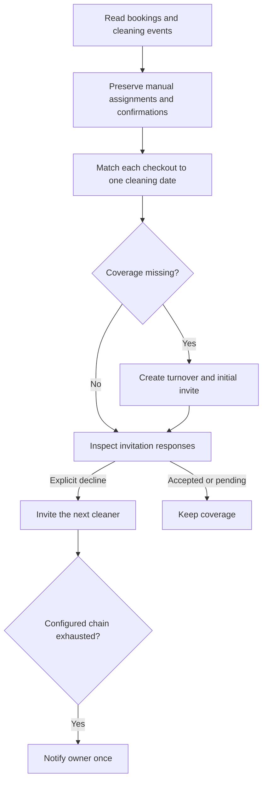

# Cleaning coverage automation

## The process

This Apps Script reviews future booking and cleaning events, identifies uncovered departures, creates turnover events and moves through a configured cleaner order when a cleaner explicitly declines. An accepted, pending or manually confirmed assignment is preserved. One cleaning date cannot cover two different checkout dates.

## Inputs and rules

The inputs are booking intervals, cleaning dates, invite responses, confirmation/history markers in event descriptions, a cleaner roster and priority order, a 90-day lookahead and a configurable coverage window. The example uses a one-day window and an 11:00–16:00 cleaning period.

Duplicate bookings ending on one date represent one physical turnover. Back-to-back checkouts still need distinct cleaning dates. Explicit declines advance the cascade; silence does not. A manual confirmation prevents automated reassignment. A mid-stay cleaning is removed only under the script’s orphan-cleaning rules, with manual overrides preserved.

Outputs include turnover events and invitations, updated assignment/history descriptions, removed declined invitees, repaired false exhaustion labels and a summary when something changed. A generic recent-Vrbo access-review reminder is retained without publishing any real property’s access-code policy.

## Setup and operation

1. Create a separate private Apps Script project for this workflow; its globals are separate from booking sync.
2. Add `Config.gs`, `Code.gs`, `tests.gs` and the manifest from this folder.
3. Configure a test calendar, owner contact, cleaner contacts, timezone, windows and the cascade order. The shipped roster is sample configuration.
4. Keep `RUN_ENABLED = false` until the configuration has been reviewed. The default owner uses `example.invalid` and cannot pass the execution guard.
5. Run `node tests/run-workflows.mjs` from the repository root. You can also run `runAllTests` in the Apps Script editor.
6. Populate a test calendar with accepted, declined, pending, manually confirmed, duplicate and back-to-back examples. Enable only that test project, run the check, inspect invitations and removals and run again.
7. Review optional notification adapters before enabling them. Twilio and Slack secrets belong in private Script Properties, never in this repository. The public config uses email examples and contains no working destination.
8. After reviewing the test outcome, select the operational calendar and add one daily trigger for `dailyCleaningCheck`. Review the actual timezone and trigger window.

## Pause, recovery and limits

Set `RUN_ENABLED = false` and remove this handler’s timer to pause. Preserve the calendar and event-description markers. An unexpected deletion or reassignment needs a comparison with the prior calendar state; do not repeatedly run a failing workflow to force it through.

The 81 inherited cases cover matching, cascade decisions, manual overrides, confirmations, exhausted alerts, notification routing and duplicate handling. Local tests exercise pure logic with no provider calls. Notification-provider acceptance/delivery, trigger operation and live calendar changes require separate verification. The adapters are reference integrations, not delivery receipts.
