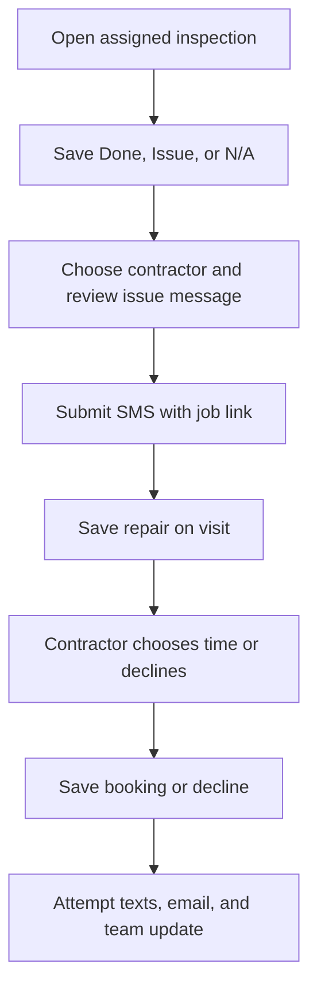

# Inspection issue to contractor booking

The recovered implementation connects a per-visit inspection checklist to a contractor request, a private booking page, and confirmation attempts. Its source lives in the same Zite application as the assignment screen; the complete application is preserved privately.

## The implemented process

The inputs are the visit, checklist tasks, issue note, selected contractor, reviewed message, and proposed appointment. Airtable stores the visit, staff roles, and task guide. Calendar assignment is a separate process.

1. The inspector opens an assigned visit. The app loads the master checklist and that visit's saved results.
2. Done, Issue, and N/A are saved in a marked block inside the visit's Notes. Each visit keeps its own results; the master checklist is unchanged. Finishing marks the visit Completed after a confirmation.
3. For an issue, the inspector selects a trade and contractor and reviews the message. The backend checks the visit association and contractor contact, generates a job reference, and submits the text with a private job link.
4. After the text request is accepted, the repair is saved in a separate Notes block. The entry contains status, task, contractor, inspector, and selected time. A repeat request for the same task replaces its earlier entry.
5. The job page offers morning and afternoon times over the next three days. It removes exact times already booked for that contractor in the saved repair records. This is not an external availability or guest-occupancy check.
6. Booking or declining saves the new state first. Booking then attempts texts to both sides, email to available addresses, and a team-channel update. Decline notifies the inspector so another contractor can be chosen manually.

The result is a saved repair status and appointment, plus notification attempts. These endpoints do not create a Calendar appointment or automatically choose another contractor after a decline.

## Source to inspect

| Part | Reviewed source |
|---|---|
| Inspection lookup and visit scope | [listMyInspections](../../reference/zite/api/listMyInspections.ts), [getInspection](../../reference/zite/api/getInspection.ts) |
| Per-visit result persistence | [saveInspection](../../reference/zite/api/saveInspection.ts), [inspection helpers](../../reference/zite/lib/inspection.ts) |
| Contractor request | [sendRepairRequest](../../reference/zite/api/sendRepairRequest.ts) |
| Available times and saved booking | [getRepairJob](../../reference/zite/api/getRepairJob.ts), [bookRepairJob](../../reference/zite/api/bookRepairJob.ts) |
| Repair persistence and notification adapters | [repair helpers](../../reference/zite/lib/repairs.ts) |
| Separate checklist team post | [submitChecklist](../../reference/zite/api/submitChecklist.ts) |

## Verification and operating boundaries

The source was read directly and preserved with its complete private manifest. The provider reported matching published/latest versions. Recent live queries contained no repair-request or repair-booking runs, so this review does not claim a delivered contractor text or a completed booking. A separate checklist-post run does not prove the repair sequence ran.

The sequence has practical recovery implications: a text can be accepted before the repair save fails; a booking can save while a confirmation fails; a retry can send another confirmation. Appointment suggestions are not a transactional conflict check. The private guide records the full error paths and identity/concurrency review needed before expanding operation.

Public endpoints stop immediately, and working addresses, staff contacts, connection IDs, database bindings, and private job links are excluded. Read [the publication changes](../../reference/zite/README.md) before adapting any source.

[Back to all projects](../../README.md)
